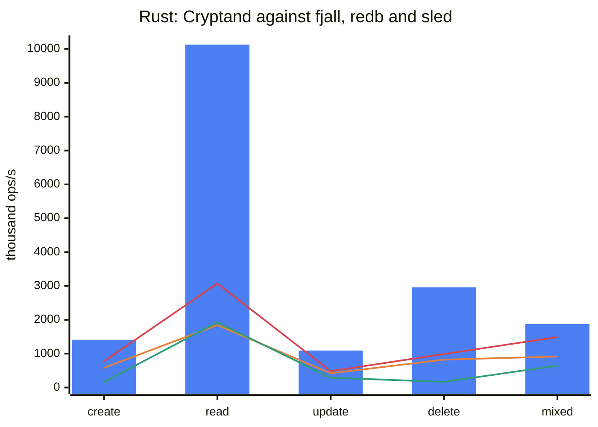
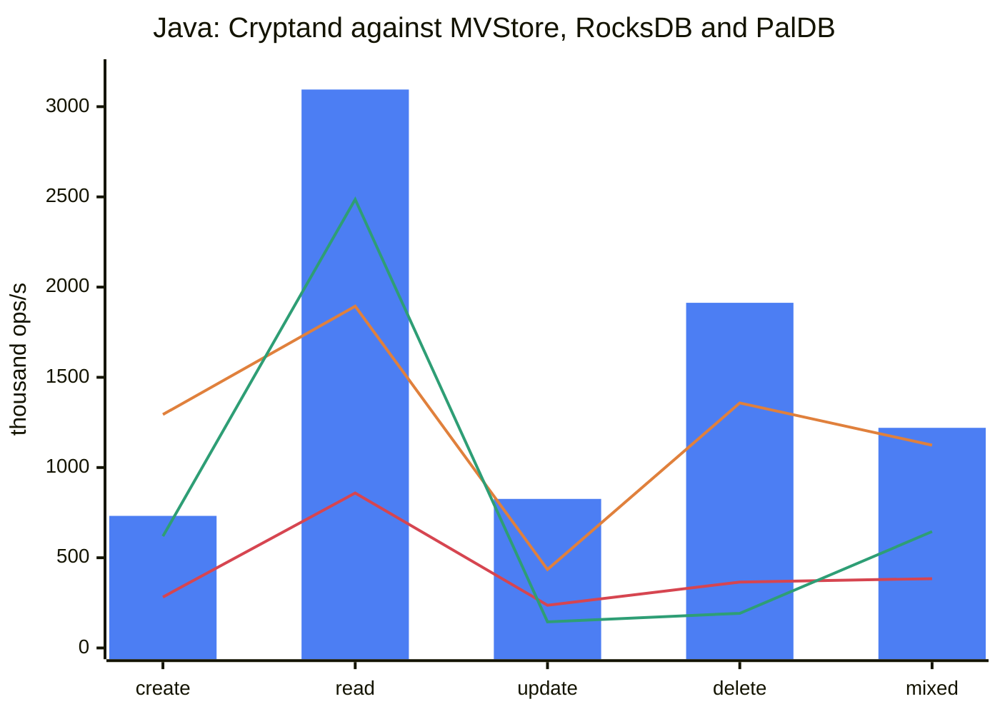
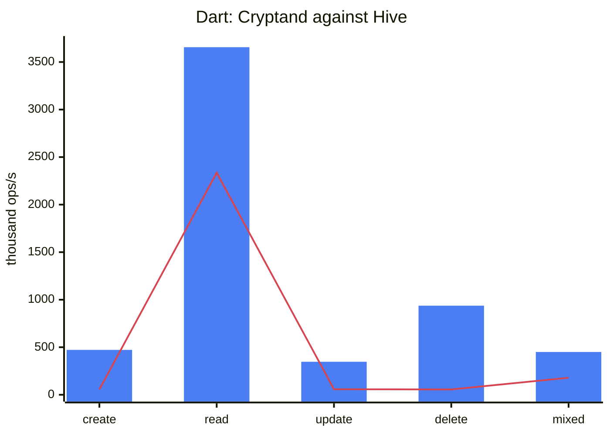
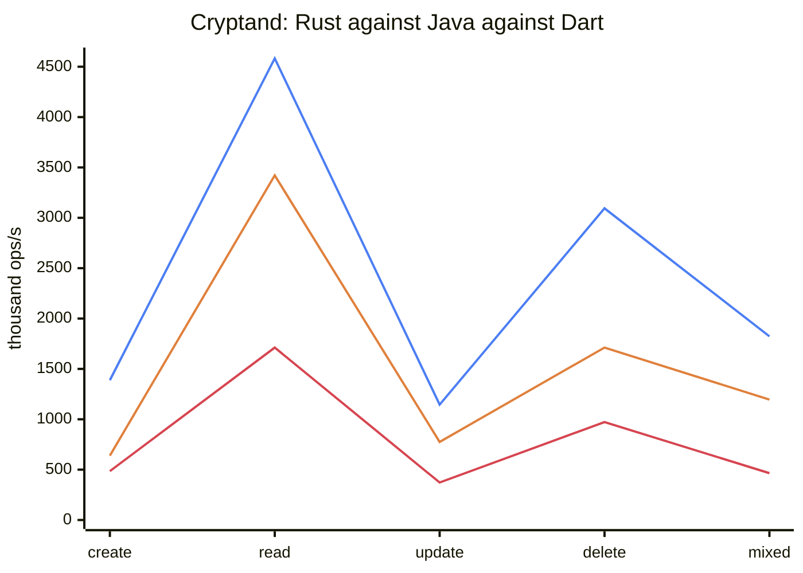

# Benchmark results

Measured 2026-09-12 on one machine: Apple Silicon, macOS/APFS, JDK 25, Dart
stable, Rust release with `lto = "fat"`. 20 000 documents, one durability
barrier per phase. Every number is the **median of 3 runs**, and every run
discards a first pass on a fresh database, because a few thousand operations on
a cold process measure the process (and on the JVM, the interpreter).

All harness code is outside the published artifacts: Java's benchmarks are
`test` scope, Dart's are outside `lib/`, Rust's are behind a non-default
`harness` feature, and each comparison suite is a separate crate, scope or
package, so no rival engine is in anybody's dependency tree but the benchmark's.

## 1. Each implementation against its field

`reference/bench/run_compare.sh`. Operations per second, higher is better.
"On disk" is the file after the run; Cryptand's is after `shrink()`, which is
untimed.

### Rust: Cryptand against fjall, redb and sled

| row | **cryptand** | fjall | redb | sled |
|---|---|---|---|---|
| create | **1 410 006** | 580 545 | 777 371 | 161 454 |
| read | **10 127 864** | 1 843 113 | 3 071 745 | 1 922 954 |
| update | **1 092 349** | 419 421 | 484 330 | 288 727 |
| delete | **2 956 904** | 824 029 | 988 647 | 166 376 |
| mixed | **1 875 000** | 914 777 | 1 489 393 | 646 188 |
| on disk (MB) | **20.9** | 67.1 | 33.7 | 51.4 |



*Bars are Cryptand; the lines are fjall, redb and sled.*

**Cryptand leads every row against all three.** The narrowest lead is mixed
against redb, 1.26×; read is 3.3× redb's. Reads call `get_ref`, a handle, in every
engine. redb is a copy-on-write B-tree with no background compaction; fjall and
sled are LSMs, closer in shape to Cryptand.

### Java: Cryptand against MVStore, RocksDB and PalDB

| row | **cryptand** | mvstore | rocksdb | paldb |
|---|---|---|---|---|
| create | 731 725 | **1 293 665** | 281 972 | 619 082 |
| read | **3 095 496** | 1 893 730 | 859 476 | 2 486 171 |
| update | **826 441** | 434 768 | 237 126 | 145 177 |
| delete | **1 912 838** | 1 357 835 | 365 345 | 191 738 |
| mixed | **1 220 238** | 1 124 206 | 383 546 | 644 790 |
| on disk (MB) | 20.9 | 33.1 | 20.3 | **10.2** |



*Bars are Cryptand; the lines are MVStore, RocksDB and PalDB.*

**Cryptand leads every row against RocksDB and PalDB, and every row but create
against MVStore.**

- **MVStore leads create because its `put` never reaches the device.** It is
  file-backed here (`MVStore.Builder().fileName(...)`), but its
  `auto_commit_delay` is 1 000 ms, so the whole file lands in the one
  `store.commit()` the create phase times.
- **PalDB is a write-once store**: an immutable file with a perfect-hash index.
  The `net.soundvibe` fork adds a write buffer compacted into a new file on
  `flush`, which is the only reason update and delete rows exist; read those as
  the fork's buffer, not as PalDB.
- **The Java read row is the noisiest number here.** Its phase is 5 000 reads,
  about 1.5 ms, and a single run can land below PalDB's.

### Dart: Cryptand against Hive

| row | **cryptand** | hive |
|---|---|---|
| create | **472 077** | 55 890 |
| read | **3 656 307** | 2 336 449 |
| update | **347 222** | 57 542 |
| delete | **937 383** | 56 382 |
| mixed | **450 238** | 178 527 |
| on disk (MB) | 21.2 | **10.2** |



*Bars are Cryptand, the line is Hive.*

**Cryptand leads every row**, by 1.57× on read and 2.5× to 16.6× on the rest.

- **Reads call `getView`**, a handle, in both, as the other two tables do.
  Cryptand's copying `get` is about 28 % slower and level with Hive.
- **A Hive `Box` keeps every value in memory**: `openBox` reads the whole file
  into a map and serves every `get` from it. `LazyBox` reads from disk but its
  `get` is asynchronous, so a row for it would measure the event loop.

## 2. The three implementations against each other

`reference/bench/run_xlang_crud.sh`: the same workload in all three, same
documents encoded before the clock starts, same keys, profile (`desktop`),
durability and pseudo-random sequence.

| row | rust | java | dart |
|---|---|---|---|
| create | **1 387 692** | 638 678 | 484 531 |
| read | **4 582 775** | 3 420 850 | 1 711 743 |
| update | **1 145 191** | 774 783 | 372 218 |
| delete | **3 093 899** | 1 711 816 | 971 628 |
| mixed | **1 822 676** | 1 195 237 | 465 344 |
| persist (ms) | 0.0 | 0.1 | 10.7 |
| shrink (ms) | 21.0 | 20.8 | - |
| file bytes | **20 840 448** | **20 840 448** | 21 102 592 |
| storage model | file-backed, segments resident | file-backed | in-memory page space |



*Bars are Rust; the lines are Java and Dart.*

**Rust leads every row, Java is second and Dart third.** Reads here call `get`,
a copy, in all three, which is why they sit below the comparison tables' rows.

**The storage model is the largest term in any gap, so read it first.** Rust and
Java write segments into the file as they go; Java also commits on a background
thread, so part of each flush lands outside the phase's clock. Dart keeps
segments in memory and places them only when it saves, which is what `persist`
costs it.

**File size.** All three hold the same live data. A full compaction writes its
output while its input is still live, so a file-backed engine ends a run with
that input's space free in front of its data; `shrink()` moves the live extents
down over it and truncates, and Rust and Java then end at the same byte count.
Dart never has that space in its file, so it has nothing to shrink, and it ends
32 pages larger.

## 3. Memory

Rust through a counting global allocator in the bench, Java as live heap after a
full GC and as the smallest `-Xmx` that completes, all three as peak RSS of one
engine per process on the comparison suite minus a process that builds the
fixtures and runs nothing.

| | |
|---|---|
| rust, heap peak inside `compact()` | 44.0 MB |
| rust, peak RSS above baseline | 70.6 MB |
| java, heap retained after `compact()` | 13.7 MB |
| java, smallest `-Xmx` that completes (fixtures alone: 40 MB) | 72 MB |
| live segments at the end of the run: rust, java, dart | 20.8, 21.6, 20.9 MB |

Against the field, peak RSS above baseline: Rust Cryptand 70.6 MB, fjall 26.9,
redb 34.2, sled 72.2. Java Cryptand needs 72 MB of heap where MVStore needs 48,
and RocksDB and PalDB fit in 40 because both keep their data off the Java heap.
Dart Cryptand peaks at about 80 MB, Hive at about 100.

## 4. Known gap

A workload where every document goes to the value log does not end at the same
file size in all three. The difference is value-log collection policy (when a
segment qualifies, and whether an emptied one is dropped), not a leak.

## 3. Dart open at 10⁷ documents (PLAN 5.5 Verify)

`dart/cryptand/tool/rss_scale.dart` (now `tool/scale.dart`), AOT (`dart compile exe`), remote Mac
(Apple M1, 16 GB, internal SSD), 2026-10-13, branch `dart-storage` 63319c3.
`build`: 10⁷ `benchDoc` documents, commit per 10⁵, desktop profile, plaintext:
6 892 027 904 B file; writer RSS 121–604 MB (sampled at each commit).
`open` (fresh process): open + 10 000 random gets, 0 missing:
**peak RSS 58 MB** (`/usr/bin/time -l`: 61 652 992 B) against the budget
128 MB (desktop page cache 64 MB + 64 MB): **PASS**. Wall 393 s (336 s user).
Under `dart run` (JIT) the same check peaks near 265 MB from the compiler alone.

## 5. Scale rungs (PLAN M6)

Remote M1, 16 GB, internal SSD, desktop profile, plaintext, `benchDoc`
(516 B logical), commit per 10^5. Dart: `tool/scale.dart` AOT; Rust:
`examples/rss_scale.rs` (build, then `read`: open + 10k uniform gets).

| rung | impl | load docs/s | file | space amp | writer RSS | get p50 / p99 uniform | read RSS | verify | bars |
|---|---|---|---|---|---|---|---|---|---|
| 10^6 | Dart (10-13) | 18 641 | 744 MB | 1.44 | 159 MB | 36 / 72 ms | 814 MB | 3.6 s sound | FAIL: F-151 |
| 10^6 | Rust (10-13) | — | 487 MB | 0.94 | — | 7.6 / 7.7 ms | — | — | FAIL: F-151 |
| 10^7 | Java (10-14) | 135 000 | 7.07 GB | 1.37 settled | 682 MB at -Xmx512m, 438 at 256m, 301 at 128m | 86 / 582 us | 220 MB | — | PASS at -Xmx128m (JVM footprint tracks -Xmx, not N); open 111 ms |
| 10^8 | Rust (10-15) | 136 000 | 44.9 GB | 0.84 settled | 281 MB | 226 / 1035 us (p999 2601) | 291 MB | — | FAIL: settle footprint 408 MB (F-161); read needed F-160 |
| 10^8 | Rust (10-15, F-161 B) | 135 000 | 43.7 GB | 0.84 settled | 189 MB | 228 / 980 us (p999 1226) | 290 MB | — | PASS: settle footprint 315 MB (was 408) |
| 10^8 | Java (10-15) | — | OOM at 15 GB | — | OOM at -Xmx128m (~2x10^7 docs) | — | — | — | FAIL: F-161 |
| 10^8 | Java (10-15, F-161 B) | ~10 docs/s after stall | 0.45 GB at 10.7 h | — | — | — | — | — | FAIL: F-164 (compactor OOM, writer stalled forever) |
| 10^8 | Java (10-17, F-167) | 87 600 | 69.1 GB | 1.34 settled | 214 MB footprint at -Xmx128m | 241 / 1051 us (p999 1653) | 182 MB footprint | — | PASS: build, read (open 304 ms), settle 203 MB footprint |
| 10^8 | Dart AOT (10-17, @8fdbc3c) | 9 655 | 70.3 GB | 1.36 | 223 MB footprint | 642 / 1422 us (zipf p50 222) | 467 MB footprint | 8.4 h sound | FAIL: read footprint (F-168, verify filter decoded per entry; fixed c4f80d9, rerun pending); settle PASS 113 MB |
| 10^8 | Dart AOT (10-18, F-168+F-169) | 9 665 | 70.3 GB | 1.36 | 221 MB footprint | 650 / 1397 us (zipf p50 223) | 246 MB footprint | 510 s sound | PASS: build, read (scan 436k rows/s), settle 113 MB |
| 10^8 | Rust (10-18, full read rung) | 136 000 | 43.7 GB | — | 145 MB footprint | 211 / 994 us (zipf p50 125); scan 1.30M rows/s | 382 MB footprint | 33 s sound | FAIL: read (F-170, scan materializes the range) |
| 10^8 | Rust (10-18, F-170 cursor) | — | 43.7 GB | — | — | 205 / 1025 us (zipf p50 122); scan 3.16M rows/s | 305 MB footprint | 32 s sound | PASS: read (open alone 230 MB) |
| 10^8 | Rust (10-18, F-171) | — | 43.7 GB | — | — | 224 / 1038 us (zipf p50 125); scan 3.08M rows/s | 180 MB footprint | 32 s sound | PASS: read (open 3 MB) |
| 10^8 | Java (10-18, full read rung) | 88 600 | 69.1 GB | — | 223 MB footprint at -Xmx128m | 241 / 1055 us (zipf p50 142); scan 623k rows/s | 189 MB footprint | 119 s sound | PASS: build, read |
| 10^8 enc | Rust (10-19, b563988) | 65 300 | 43.7 GB | 0.84 settled | 188 MB footprint | 504 / 1322 us (zipf p50 164); scan 362k rows/s | 177 MB footprint | 137 s sound | PASS: build, read, settle 288 MB (F-172..F-174) |
| 10^8 enc | Java (10-20, 3831966) | 40 200 | 69.0 GB | 1.34 settled | 237 MB footprint at -Xmx128m | 344 / 1784 us (zipf p50 204); scan 224k rows/s | 194 MB footprint | 536 s sound | PASS: build, read, settle 200 MB |
| 10^8 enc | Dart AOT (10-21) | 2 327 | 70.2 GB | 1.36 | 219 MB footprint | 2261 / 4040 us (zipf p50 538); scan 71k rows/s | 246 MB footprint | 2832 s sound | PASS on memory: build, read, settle 113 MB; speed: F-175 |
| 10^8 enc | Dart AOT (10-21, F-175 b4f74f1) | 7 347 | 70.2 GB | 1.36 | 213 MB footprint | 2262 / 3567 us (zipf p50 540); scan 72k rows/s | 250 MB footprint | 2826 s sound | PASS: build (3.8 h, was 11.9), read, settle 113 MB; reads unchanged: F-176 |
| 10^8 enc | Dart AOT (10-22, F-176 5625cf6) | 10 499 | 70.2 GB | 1.36 | 221 MB footprint | 1263 / 2444 us (zipf p50 329); scan 154k rows/s | 244 MB footprint | 1336 s sound | PASS: build (2.6 h), read, settle 114 MB; vs plain 10^8: get 1.9x, scan 2.8x, verify 2.6x |

### Mobile profile (PLAN 6.2), plaintext

Remote M1, `CRYPTAND_PROFILE=mobile` (4 KB pages, 4 MB page cache), ebf2224, 10-22. Bar (6.3): peak
footprint <= 4 MB cache + memtables + 256 MB. Java at -Xmx128m.

| rung | impl | load docs/s | file built / settled | space amp settled | build footprint | get p50 / p99 uniform (zipf p50) | scan rows/s | read footprint | verify | bars |
|---|---|---|---|---|---|---|---|---|---|---|
| 10^6 | Rust | 125 000 | 0.61 / 0.47 GB | 0.90 | 14 MB | 6 / 13 us (4) | 2.02M | 14 MB | 0.3 s | PASS |
| 10^6 | Java | 138 000 | 0.79 / 0.78 GB | 1.51 | 223 MB | 16 / 94 us (9) | 1.21M | 165 MB | 0.7 s | PASS |
| 10^6 | Dart AOT | 26 371 | 1.32 / 0.71 GB | 1.37 | 112 MB | 84 / 107 us (26) | — | 120 MB | — | PASS |
| 10^7 | Rust | 120 000 | 4.77 / 4.69 GB | 0.91 | 15 MB | 21 / 26 us (20) | 2.02M | 18 MB | 2.9 s | PASS |
| 10^7 | Java | 86 000 | 7.92 / 7.81 GB | 1.51 | 228 MB | 62 / 384 us (40) | 1.32M | 170 MB | 7.1 s | PASS (p99 4.1x the 10^6 p99, ahead of the 10^8 check) |
| 10^7 | Dart AOT | 15 317 | 7.58 / 7.06 GB | 1.37 | 121 MB | 145 / 165 us (143) | — | 123 MB | — | PASS |
| 10^8 | Rust | 65 600 | 46.5 / 93.2 GB | 1.81 | 216 MB | 484 / 938 us (313) | 1.10M | 55 MB | 53 s sound | PASS on memory (settle 127 MB); settle doubled the file: F-179 |
| 10^8 | Rust (F-179 fixed, 10-26) | 65 600 | 46.5 / 46.8 GB | 0.91 | 216 MB | — | — | — | — | PASS (settle 120 MB) |
| 10^8 | Java (ed6893d, F-177/F-178) | 16 800 | 73.0 / 72.8 GB | 1.41 | 227 MB | 1710 / 2580 us (1398) | 606k | 186 MB | 177 s sound | PASS (settle 191 MB) |
| 10^8 | Dart AOT (ed6893d) | 3 195 | 71.1 / 70.6 GB | 1.37 | 135 MB | 1268 / 1590 us (1121) | 246k | 141 MB | 536 s sound | PASS (settle 88 MB) |

## 6. Java writer scaling: concurrent vs single-writer prototype (10-27)

Branch `java-single-writer`, remote M1 / APFS, desktop profile, puts/s,
`WriterScaleBench` (one put per commit). *single* = `-Dcryptand.singleWriter=true`:
steps 3-6 of 10 §2 under one lock, the durability wait outside it. Not Level 0
(11 §1.1); a prototype to measure what concurrent writers buy.

| durability | value | mode | 1 thr | 2 | 4 | 8 | 16 |
|---|---|---|---|---|---|---|---|
| os | 100 B | multi | 456k | 506k | 455k | 512k | 544k |
| os | 100 B | single | 478k | 413k | 321k | 749k | 573k |
| os | 4 KiB | multi | 26.9k | 34.1k | 20.8k | 8.1k | 4.3k |
| os | 4 KiB | single | 29.3k | 22.8k | 12.9k | 6.7k | 2.9k |
| sync | 100 B | multi | 61 | 83 | 142 | 266 | 477 |
| sync | 100 B | single | 61 | 73 | 139 | 266 | 474 |
| sync | 4 KiB | multi | 42 | | 123 | | 361 |
| sync | 4 KiB | single | 42 | | 111 | | 355 |

- Group commit (`sync`, ~8x at 16 threads) is the same in both modes.
- `os` scales in neither mode on this host; 10 §2's 14.8x is not reproduced here.
- Single loses 20-35 % at 4 KiB: value-log encode/write no longer runs in parallel.
- Both modes lose throughput with threads at 4 KiB: F-180.

### 6.1 After F-180, optimized single writer (10-27)

F-180 fixed (`clusterIfNeeded` liveness scan due-gated). Single writer now
serializes steps 4-6 only; value-log appends (step 3) and the durability wait
(step 7) stay concurrent. Fixed total ops split across threads: `os` 160 000,
`sync` 4 000. puts/s; *multi* = `-Dcryptand.singleWriter=false`.

| durability | value | mode | 1 thr | 2 | 4 | 8 | 16 |
|---|---|---|---|---|---|---|---|
| os | 100 B | multi | 401k | 550k | 632k | 940k | 790k |
| os | 100 B | single | 447k | 529k | 706k | 792k | 901k |
| os | 4 KiB | multi | 52.8k | 41.7k | 46.8k | 36.9k | 39.3k |
| os | 4 KiB | single | 50.9k | 37.9k | 43.0k | 38.9k | 35.5k |
| sync | 100 B | multi | 64 | 87 | 178 | 317 | 629 |
| sync | 100 B | single | 64 | 81 | 149 | 295 | 576 |
| sync | 4 KiB | multi | 48 | 86 | 133 | 257 | 454 |
| sync | 4 KiB | single | 47 | 83 | 133 | 253 | 485 |

- Single vs multi within ~10 % either way (worst: 100 B `sync` 4 thr, -16 %);
  the prototype's 20-35 % loss at 4 KiB is gone.
- 4 KiB `os` at 1 thread: 52.8k (was 26.9k with 20k ops, 3.5k at 1.3 GB).

## 7. Index rung (PLAN 6.5, 10-27 to 10-29)

The 10^N documents carry one unique index (`ordReference`) and one compound
index (`custCityName` across 1000 cities, then `ordTotMinorU`), so there are
three trees. The rung runs probes, `analyze` and `verify`. The bar is peak
footprint ≤ 416 MB: 64 MB of cache, 32 MB of memtable for each of 3 trees, plus
256 MB. All runs below have `verify` sound.

| N | impl | unique probe p50 | peak footprint | result |
|---|---|---|---|---|
| 10⁶ | Rust | 7 us | 375 MB | PASS |
| 10⁷ | Rust (F-186, F-187) | 5 us, 4 segments/probe | 356–516 MB across runs | spread open (F-184) |
| 10⁶ / 10⁷ | Java, -Xmx128m (F-185) | 7 us | 233 / 220 MB | PASS |
| 10⁶ | Dart AOT | 5 us | 312 MB | PASS |
| 10⁷ | Dart AOT | 32 us | 484–509 MB | FAIL: GC garbage from `analyze` scans (F-184); fix 23ffb57, rerun pending |

Still to run: 10⁸ Rust index, 10⁷ full text, 10⁷ spatial, HNSW recall@10 at 10⁶ × 128-d.

## Running it

```bash
reference/bench/run_compare.sh      # section 1
reference/bench/run_xlang_crud.sh   # section 2
reference/bench/run_all.sh          # the design-model suite, README.md
```

Each takes an optional document count and mixed-operation count. Read
`README.md` beside this file before comparing two columns: it says, row by row,
which are comparable across implementations and which are not.
